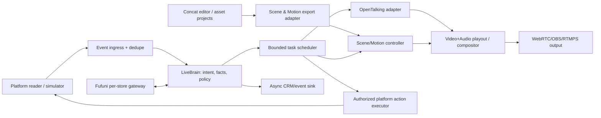

# 01 — Kiến trúc đích, biên giới trách nhiệm và failure domains

## Bài toán

Một avatar AI biết diễn theo kịch bản bán hàng, nhận comment có thật, trả lời chính xác dữ liệu sản phẩm, thay cảnh/cử chỉ đúng tình huống, vẫn phát A/V khi network/AI lỗi. MVP: **1 desktop / 1 store / 1 avatar / 1 live session / 1 platform test/mock**; đa tenant đa GPU sau.

## Cấu trúc nguyên lý

**Không tuyến `Cloudflare → frame renderer`**. GPU/video local hoặc GPU server gần output. Dịch vụ remote chỉ trả dữ kiện và điều khiển. Không để LLM gọi trực tiếp thiết bị/OBS/financial API.

## Modules và ownership

| Module | Owns | Does NOT own | Fault isolation |
|---|---|---|---|
| Concat | offline edit/asset authoring, template manifests | live audio clock, comment traffic | editor lỗi không gián đoạn phiên đã load assets |
| OpenTalking | avatar, session, speech/TTS if configured, media backend | commerce rules, store price | worker fail -> fallback/b-roll |
| Live Runtime/Brain | session state, queue, intent, policy, routing | rendering neural frames | network timeout non-blocking |
| ProductSession | trusted product revision/TTL and binding | original POS ledger/order | snapshot stale -> safe unknown answer |
| PlatformAdapter | read events, optionally authorized actions | LLM answer synthesis | disconnected -> reconnect, no fake ACK |
| LiveCompositor | deterministic scene timing/PTS, overlays | per-comment LLM/DB requests | always stable fallback source |
| OperatorDashboard | controls/visibility, emergency stop | credentials stored in browser | manual takeover path independent of LLM |
| Event sink | analytics, Twenty | critical playback | async spool + bounded retention |

## Deployment profiles

- **Profile A DEV:** Concat/editor + mock OpenTalking + mock platform + mock Fufuni + runtime on loopback. No cloud keys/GPU.
- **Profile B SINGLE GPU PILOT:** same host Kedi runtime and OpenTalking/OmniRT, capture output OBS/RTMPS where supported; platform reader read-only until approved.
- **Profile C SPLIT GPU:** desktop control UI, backend runtime on managed GPU machine over authenticated secure transport; asset store with signed URLs and version pin, not Worker frame relay.
- Profile D multi-session postponed until pilot pass. Kedi SaaS Nest control plane can provision sessions but does not become media-loop dependency.

## Internal transport

- UI/control → local API over loopback; SSE/WebSocket for telemetry/status only; media over existing OpenTalking WebRTC/RTMP/OBS paths. Prefer existing authenticated RPC if available.
- Define `SessionCommand` idempotent with `command_id`, `session_id`, `expected_version`, `trace_id`. Commands `start`, `stop`, `mute`, `unmute`, `takeover`, `set_featured_sku`, `pause_script`, `resume_script`, `simulate_event`, `enqueue_operator_speech`.
- Store recent command IDs in SQLite/in-memory with TTL; reply duplicate with same result and no second action.
- `event_ingress` never sends events straight to audio API: always through task policy/scheduler.
- UI should not directly manipulate RTMP/FFmpeg process handles.

## Concurrency/failure budget

- Separate asyncio network/LLM handling from CPU and GPU tasks (thread/process worker, queue). Bounded queues with explicit drop/coalesce policy; never wait unbounded on external provider.
- Single writer/session for playout timeline and mutable ProductSession; serialize transitions and detect stale version.
- Prefer one speech writer/session. Media sends PTS in a common clock; job deadlines use monotonic time local, wall UTC only for audit.
- A/V must continue with idle video/b-roll and silence/music (licensed asset) when LLM/TTS stalls. Fail open for *media continuity*, fail closed for *financial/product actions*.
- Crash/restart: session state `RECOVERING`, do not auto-publish twice, reconcile streaming engine/platform states before resuming. Operator can always stop.

## ADR (phải hoàn tất theo repo audit)

`ADR-0001`: sidecar vs embedded Python; `ADR-0002`: OpenTalking speech completion/interrupt; `ADR-0003`: media output path; `ADR-0004`: product data authority; `ADR-0005`: platform read/write capability; `ADR-0006`: model/asset licenses. Không đưa đường dẫn giả dưới dạng observed files.
