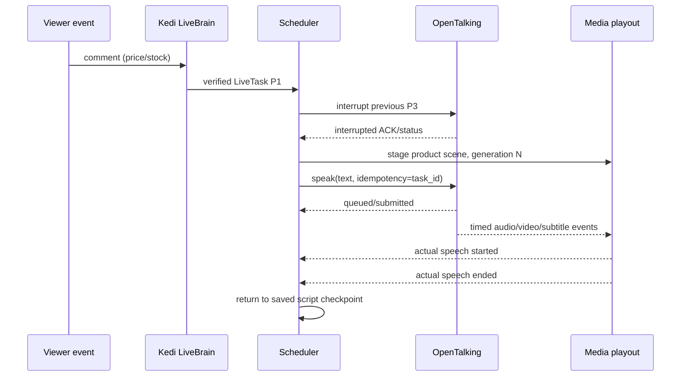

# 04 — OpenTalking Adapter, âm thanh–video đồng bộ, fallback, GPU

## Thực tế upstream đã kiểm tra, yêu cầu đối chiếu bản fork

- API upstream dùng session management qua FastAPI, Redis (ít nhất ở một số deployment paths), `POST /{session_id}/speak` nhận text với `mode=replace`, hỗ trợ `command_id`/`Idempotency-Key`; `POST /{session_id}/interrupt` có đường riêng. Điều này **không đồng nghĩa** `speak` đã kết thúc playback khi HTTP response về.
- `POST /{session_id}/speak_audio` của upstream là upload audio → STT → pipeline hội thoại; **không dùng làm đường inject PCM/TTS thẳng**. Có thể upstream có API khác hoặc event audio; Codex phải audit.
- Upstream docs mô tả REST, SSE, WebSocket, WebRTC và streaming outputs RTMPS/WHIP, nhưng khả năng phụ thuộc model backend/profile. Capability probe + integration tests trước khi dùng.
- Upstream OpenTalking routes có thể không tự auth; phải đặt sau localhost gateway/secure reverse proxy (đối chiếu code fork).

## Adapter interface + state

`OpenTalkingAdapter` wraps engine specifics: `capabilities()`, `create/start/stop_session()`, `submit_text(text, command_id, generation_id, ...)`, `interrupt()`, `listen_events()`, `health()`, `get_stream_endpoint()`. Sidecar maps `kedi_session_id -> opentalking_session_id` with owner epoch; do not recreate unconditionally after reconnect.

State `DISCONNECTED`, `CONNECTING`, `READY`, `SPEAKING`, `INTERRUPTING`, `DEGRADED`, `FAILED`. On reconnect, don't replay old `speak` automatically unless idempotency/correlation prevents duplicate audio. If upstream cannot report STARTED/FINISHED reliably, document limitation and use playout proxy events. `command_id` must include Kedi task ID, not viewer text.

## Sequence for buyer interruption

Nếu `interrupt` ACK chưa loại bỏ tất cả frame/audio cũ, Kedi playout guard drop theo generation/cancel epoch trước khi xuất. Khi không có metadata audio/video từ OpenTalking, không tự build một compositor packet-level phức tạp ở P2; dùng sẵn output path và chỉ overlay ở OBS/scene level cho MVP.

## Audio master clock / media

- PCM target 48kHz, monotonic PTS nanosecond, consistent frame rate 25/30 fps pilot; resample chỉ ở boundaries. Actual clock ownership depends on existing OpenTalking/WebRTC/OBS flow, choose one owner. Avoid mixing computer wall time with media PTS.
- A/V skew measured at actual playout/compositor, not LLM response. Calculate skew from synchronized timestamp or trace-specific cue, not naive network timestamps.
- Video encoder settings (720p/H.264/30FPS, CBR bitrate, keyframe 2s) are **pilot profile suggestion** subject to platform specs/GPU/OBS settings. Never blindly set all platforms to same settings.
- Render path must never block on HTTP/DB/LLM. Per-stage queue bounded; drop late video frame while preserving audio continuity. Idle frame loop / b-roll fallback with legal audio or silence. Do not reset publishing connection for every speech.
- Use a `FrameBudgetController`: monitor encode queue size, GPU memory, frametime, dropped frames; downscale/disable expensive overlay or switch video source if sustained lag.

## Engine benchmark matrix

| Engine | Baseline role | Model/download requirement | Decision |
|---|---|---|---|
| OpenTalking mock | test session/events without GPU | none/low | P0+P1 |
| QuickTalk | candidate low latency | local weights/runtime | benchmark P2 |
| Wav2Lip/MuseTalk | candidate lip sync | model weights | benchmark if installed |
| FasterLivePortrait/OmniRT | candidate richer face/head | model + OmniRT hardware | P4 experiment |
| DEEPCORE UNet binary | **not production integration** | proprietary/unverified | design reference only |

Quality score examples: face similarity (authorized identity), lip sync visual alignment, head-motion stability, occlusion glitches, VRAM, frame p50/p95, inference time, voice latency; use same footage/audio and GPU.

## Fault matrix

- LLM timeout: background video continues; safe short filler if approved, don't hallucinate facts.
- TTS timeout: avoid infinite blocking, bounded retry or neutral prerecorded answer; preserve queue epoch.
- OpenTalking worker crash: maintain broadcaster fallback, mark `RECOVERING`, restart bounded, operator notice.
- GPU OOM: kill/restart only affected inference worker if architecture allows; switch low-cost profile, no auto loop unbounded.
- Output stream disconnected: exponential backoff jitter; no duplicate concurrent publishers; human operator notified.
- User stop: stop media and background jobs reliably; LLM task cancellation and shutdown cleanup.

## Implementation tasks

1. Audit actual routes/signatures/event feeds and instrument them; capability matrix.
2. Implement fake SpeechBackend + OpenTalkingAdapter mapping correlation/command IDs.
3. Support safe speech interrupt, stale task drop, session ownership and exact `replace` semantics.
4. Prove smoke session speak/interrupt/finish on mock backend.
5. Only then test real GPU avatar, scene playout, optional WHIP/RTMPS publishing on staging stream.
